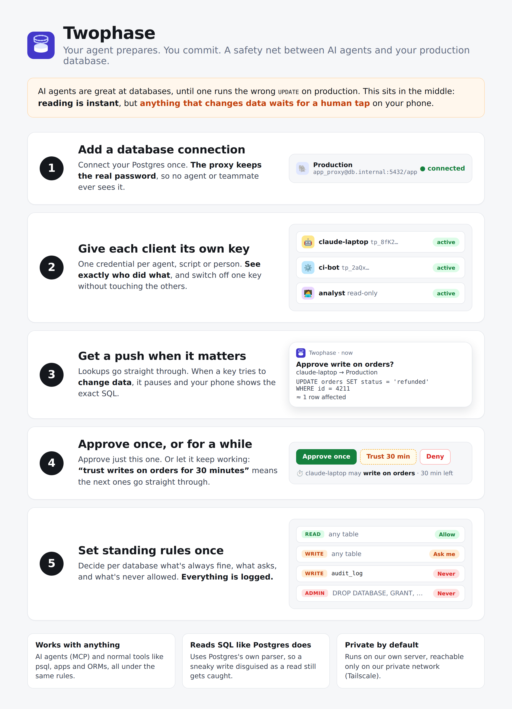

# Twophase

**Your agent prepares. You commit.**



Twophase is a database proxy with a human in the loop. The name comes from two-phase commit:
the agent prepares the change, and a human commits it. It holds the real credentials for your databases
(Postgres today), gives each client its own token, and checks **every SQL statement** before it
runs. Reads can go straight through, writes can wait for you to approve them on your phone, and
dangerous statements are refused. Agents use the proxy's own MCP; psql, apps and ORMs connect to
it as if it were Postgres. Both go through the same parser, rules, approvals and audit log.

```
 agent ──MCP (Bearer tp_…)──▶ /mcp/<db>  ─┐
                                            ├─▶ parse SQL ─▶ policy ─▶ trust window? ─▶ ask human ─▶ Postgres
 psql / app ──Postgres (SCRAM)──▶ :6432/<db>┘                                           │
                                                                                         └─▶ PWA (live UI + Web Push)
```

## How statements are judged

Every statement is parsed with **Postgres's own parser** (`libpg-query`, compiled to WASM) and
classified, together with the tables it touches:

| Operation | Includes | Default |
| --- | --- | --- |
| **read** | SELECT, SHOW, plain EXPLAIN, COPY TO | Allow |
| **write** | INSERT / UPDATE / DELETE / MERGE, TRUNCATE, COPY FROM, `SELECT … FOR UPDATE`, DML inside CTEs, side-effecting functions (`nextval`, volatile user functions, …) | Ask |
| **ddl** | CREATE / ALTER / DROP of tables, indexes, views, functions, …; `SELECT INTO`, `CREATE TABLE AS` | Ask |
| **admin** | GRANT, roles, VACUUM, `DO` blocks, server files / `COPY … PROGRAM`, `SET ROLE` and other privileged settings, `pg_terminate_backend`, `dblink`, **and anything unrecognised or unparseable** | Deny |

Some things that commonly slip past "read-only" checks are handled explicitly:
- `EXPLAIN ANALYZE` counts as whatever it runs.
- Function calls count as writes when the database catalog marks them volatile. Postgres itself
  forbids data changes in STABLE and IMMUTABLE SQL / PL/pgSQL functions.
- `EXECUTE` of a prepared statement is judged by what was prepared.
- `BEGIN READ WRITE` / `SET TRANSACTION READ WRITE` count as admin.

Transaction control and harmless session settings (`BEGIN`, `COMMIT`, `SET search_path`, …)
always pass.

**Rules** per database match an operation or one specific kind of statement, an optional table
name or glob (`orders`, `audit_*`, `app.*`) and optionally one client, with the action
Allow / Ask / Deny. The specific kinds are:

| Operation | Statement kinds you can target |
| --- | --- |
| write | INSERT (incl. COPY FROM), UPDATE, DELETE, MERGE, TRUNCATE, row locks, side-effecting functions, CALL, NOTIFY, REFRESH |
| ddl | CREATE, ALTER (incl. RENAME, COMMENT), DROP |

So "INSERT → Allow" with writes left on Ask auto-approves inserts while every UPDATE and DELETE
still waits for you. An upsert (`INSERT … ON CONFLICT DO UPDATE`) counts as both INSERT and
UPDATE, because it can change existing rows.
- **Precedence:** a client-specific rule beats an everyone rule. Then an exact table beats a glob,
  a glob beats "any table", and naming a statement kind (DELETE) beats its whole operation (write).
  Ties go to the stricter action, so "INSERT → allow" never overrides "write on audit_* → deny".
- **Strictest wins:** a statement (or a multi-statement string) gets the strictest decision of
  everything it touches.

**Ask** holds the statement until you decide or `APPROVAL_TIMEOUT_SECONDS` passes. The
approval card shows:
- the SQL and any bind parameters, the client, and whether it came via psql/app or MCP;
- the tables involved and the planner's estimated affected rows (plain `EXPLAIN`, never executed);
- warnings: `UPDATE`/`DELETE` without `WHERE`, `TRUNCATE`/`DROP`, an open transaction holding locks.

When approving you can also open a **trust window** for N minutes or until revoked. It covers
the same kind of statement on the same tables ("DELETE on orders"), that kind of statement
anywhere in the database ("any DELETE"), or everything on the database. Trust windows apply to the client on both MCP and Postgres, release
matching statements already waiting, and never override **Deny**.

### Hosted MCP (agents)

`/mcp/<db-slug>`, `Authorization: Bearer <client token>`. Tools:

| Tool | What it does |
| --- | --- |
| `query {sql, params?, maxRows?}` | Runs the statements. |
| `list_tables` | Lists tables the client may read. |
| `describe_table` | Columns, indexes, foreign keys. |
| `explain` | Plain EXPLAIN only. |

How `query` runs statements:
- **Reads** run inside `BEGIN READ ONLY … ROLLBACK`, so Postgres refuses any write the classifier
  missed.
- **Approved writes** run in one `BEGIN … COMMIT`, so a multi-statement call is atomic.
- **Not available:** transaction control, session-wide `SET` (use `SET LOCAL`), `PREPARE` and `COPY`.

Results are JSON with column names. Rows are capped per database (`maxRows`), with a
truncation flag.

### Postgres wire protocol (psql, apps, ORMs)

```sh
psql "postgresql://<client-username>:<client-token>@<proxy-host>:6432/<db-slug>?sslmode=disable"
```

**Login.** Clients log in with SCRAM-SHA-256. The proxy stores only a verifier of the token, and
the token never crosses the wire. The proxy then opens its own connection to the real database,
one upstream connection per client connection.

**Holding a statement.** psql shows `NOTICE: waiting for approval…` and blocks. Ctrl+C withdraws
the request.

**Denials.** A denied statement fails with SQLSTATE `42501` (`57014` for timeouts and cancels).
The proxy fails the statement on the real server too, so transaction state stays consistent:
- inside `BEGIN`, the transaction is aborted, and `COMMIT` becomes `ROLLBACK`;
- in a pipelined batch, earlier statements roll back with it.

**Read-only clients.** If a client's rules mean it can never write, its sessions run with
`default_transaction_read_only=on`. If the database has one configured, they also use the
**read-only login**, so Postgres enforces it.

**Rejected:**
- startup settings that change privileges or how SQL is parsed (`standard_conforming_strings`,
  non-UTF8 encodings, `default_transaction_read_only`, …);
- replication connections;
- fast-path function calls.

## Layout

| Path | What |
| --- | --- |
| `server/src/engines/postgres/` | `analyze.ts` (classifier), `functions.ts`, `executor.ts` (pool, MCP execution, estimates, catalog), `wire/` (listener, session, upstream, SCRAM, framing) |
| `server/src/` | `gate.ts` (policy → trust windows → approval → audit), `policy.ts`, `approvals.ts`, `mcp/`, `admin.ts`, `push/`, `store.ts` + `db/` (Drizzle ORM / SQLite) |
| `web/` | React + Vite admin PWA (approvals, databases, clients, activity) with Web Push |
| `ios/` | Native SwiftUI app: **unfinished**, parked until the web flow is settled |

The core (policy, approvals, audit, UI) only knows operations and table names. Another engine
(e.g. MySQL) would add a parser, an executor and a wire frontend under `engines/`.

## Run it locally

```sh
# terminal 1: proxy (admin + MCP on :8787, Postgres listener on :6432)
cd server && npm install
ADMIN_TOKEN=dev-admin-token npm run dev

# terminal 2: web UI on :5173 (proxies /admin/api and /mcp to :8787)
cd web && npm install && npm run dev
```

Open http://localhost:5173, sign in with the admin token, then:

1. **Databases → Add database.** Use a dedicated role with only the privileges you'd ever approve,
   never a superuser. "Test connection" warns about over-privileged logins.
2. Adjust the per-operation **defaults** and add **rules** (or click a table's badge to add one).
3. **Clients → New client.** Pick its databases and whether it may use MCP, Postgres or both.
   Copy the token and the generated `psql` URL, `.mcp.json` or `claude mcp add` snippet.
4. Statements that need approval appear instantly under **Approvals**. Turn on push under
   **Settings** to get them on your phone.

## Deploy

```sh
docker compose up -d --build   # admin/MCP on 127.0.0.1:8787, Postgres on 127.0.0.1:6432
```

Expose it privately, e.g. with Tailscale:

```sh
tailscale serve --bg --https=10000 http://127.0.0.1:8787   # web UI, admin API, hosted MCP
tailscale serve --bg --tcp=6432 tcp://127.0.0.1:6432       # Postgres clients
```

The Postgres listener does not offer TLS to clients; run it on a private network (WireGuard /
Tailscale) or behind a TLS-terminating proxy. SCRAM means the token is never sent, even
without TLS. TLS from the proxy to your database follows each database's `sslmode`.

### Sign in with Tailscale instead of an admin token

```sh
HOST=127.0.0.1 ADMIN_AUTH=tailscale ADMIN_TAILSCALE_ALLOW=tag:admin-client node dist/index.js
```

For each admin request the proxy takes the caller's tailnet IP from `X-Forwarded-For`, which
`tailscale serve` sets and overwrites. It asks the local `tailscaled` which device that is, and
allows it only if it matches `ADMIN_TAILSCALE_ALLOW`. Entries are a tag (`tag:admin-client`), an
owner login (`alice@github`) or a machine name, comma separated.

- **Allow only the devices you approve from, never machines where agents run.** Otherwise an
  agent could approve its own statements. Tagged devices work: identity headers aren't sent for
  them, which is why the proxy uses whois instead.
- The proxy refuses to start in this mode unless it's bound to loopback with a non-empty
  allow-list. Processes on the proxy host itself are trusted.
- Switching to this mode deletes the stored admin token. Client tokens are unaffected.
- In Docker, mount `/var/run/tailscale/tailscaled.sock` (or set `TAILSCALE_SOCKET`).

### Push notifications (PWA / Web Push)

The web app is an installable PWA, and approval requests arrive as standard Web Push (VAPID). That
covers Chrome, Edge, Firefox and Safari on macOS, plus **iOS/iPadOS 16.4+ once the app is added
to the Home Screen** (Share → Add to Home Screen, open it from there, then Settings → Enable).

- Chrome/Edge/Android notifications have **Approve** / **Deny** buttons. They act without
  unlocking the device; remove the `actions` in `web/public/sw.js` if that's too permissive.
  Safari opens the approval instead.
- Push needs HTTPS (or `localhost`) and outbound access from the proxy to the push services.
- VAPID keys are generated on first boot and stored in the database. Set `VAPID_SUBJECT` to a real
  `mailto:`/`https:` contact, because Apple rejects placeholders.

### Configuration (env)

| Var | Default | Notes |
| --- | --- | --- |
| `PORT` / `HOST` | `8787` / `0.0.0.0` | Web UI, admin API, hosted MCP |
| `WIRE_PORT` / `WIRE_HOST` | `6432` / `HOST` | Postgres listener; `WIRE_ENABLED=false` turns it off |
| `WIRE_PUBLIC_PORT` | `WIRE_PORT` | Port shown in client snippets (if something in front remaps it) |
| `DATA_DIR` | `./data` | SQLite database |
| `ADMIN_TOKEN` | generated | If unset, generated on first boot and printed once (only its hash is stored). `RESET_ADMIN_TOKEN=1` rotates it |
| `ADMIN_AUTH` | `token` | `tailscale` = no token, authenticate by tailnet device |
| `ADMIN_TAILSCALE_ALLOW` | — | Required with `ADMIN_AUTH=tailscale`, e.g. `tag:admin-client` |
| `TAILSCALE_SOCKET` | `/var/run/tailscale/tailscaled.sock` | tailscaled LocalAPI socket |
| `APPROVAL_TIMEOUT_SECONDS` | `300` | A held statement fails after this long |
| `WEB_DIR` | `../web/dist` | Built UI to serve at `/` |
| `VAPID_SUBJECT` | `mailto:admin@example.com` | Contact for push services. **Set this** |
| `VAPID_PUBLIC_KEY`, `VAPID_PRIVATE_KEY` | generated | Optional; keep stable or subscriptions break |
| `APNS_KEY_ID`, `APNS_TEAM_ID`, `APNS_KEY_PATH`, `APNS_BUNDLE_ID` | — | Native iOS push (for the native app later) |

Per-database settings (in the UI) include the statement timeout, max rows per MCP result, TLS
mode and an optional read-only login.

## Admin API

`/admin/api/*` (admin token or Tailscale identity):
- `databases`, plus `/:id/test` and `/:id/tables`
- `users`, plus `rotate-token`
- `rules`
- `grants`
- `approvals`, plus `/:id/decision` with `scope` set to `once`, `tables`, `operation` or `database`
- `audit`
- `push/*`
- `events`: an SSE stream of `approval.*`, `grant.*` and `audit`

## Security notes / known gaps

- **Database passwords** are stored in plaintext in SQLite. Protect `DATA_DIR`.
- **Classification has limits.** It's conservative, but views and functions can hide behaviour:
  a view calling a volatile function reads as a read. The MCP read path is still enforced by
  `READ ONLY`. On the wire path, use least-privilege roles and the read-only login.
- **Not supported yet on the wire:**
  - client-side TLS, SCRAM channel binding and GSSAPI;
  - connection pooling;
  - protocol 3.2;
  - replication;
  - COPY over MCP.
- **A held statement inside a transaction keeps its locks.** Upstream sessions get
  `idle_in_transaction_session_timeout` set just above the approval timeout.
- **The PWA keeps the admin token** (token mode) in localStorage and IndexedDB, so the service
  worker can act on notifications.

## Development

```sh
cd server && npm test      # classifier, policy, MCP + wire integration (real Postgres), Web Push
cd web && npm run typecheck
```

The integration tests need a throwaway Postgres; each test file creates and drops its own
database:

```sh
docker run -d --name mcpp-test-postgres -e POSTGRES_USER=mcptest -e POSTGRES_PASSWORD=mcptest \
  -e POSTGRES_DB=shop -p 127.0.0.1:55432:5432 postgres:17-alpine
# or point PG_TEST_URL at another superuser URL
```

### Database (Drizzle ORM)

The schema lives in `server/src/db/schema.ts`; migrations are generated SQL in `server/drizzle/`,
applied on startup.

```sh
cd server
npm run db:generate -- --name add_something   # after editing schema.ts; commit the generated SQL
npm run db:studio                             # browse the DB (uses DATA_DIR, default ./data)
```
