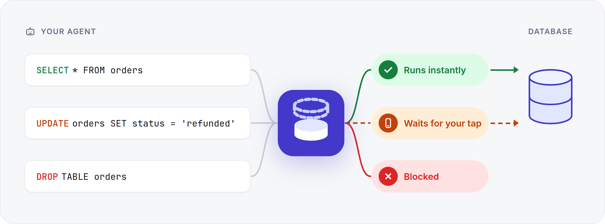
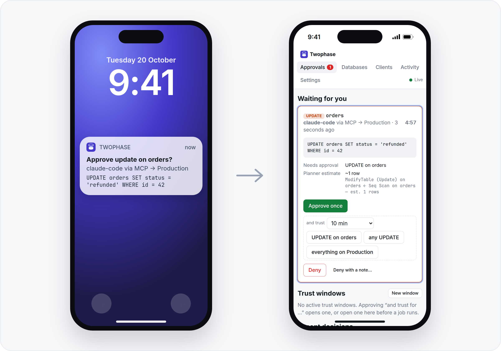
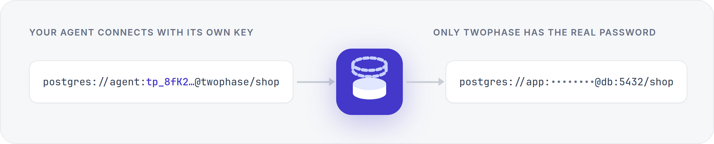

<p align="center"></p>
<h1 align="center">Twophase</h1>
<p align="center"><b>Human-in-the-loop database proxy designed for agents.</b></p>







<p align="center">Works with Postgres, MySQL and MariaDB, over MCP or a normal connection string.</p>

**Engines.** Postgres; anything that speaks Postgres's protocol and SQL (Supabase, Neon,
Timescale, AlloyDB, CockroachDB, …) uses the Postgres engine. MySQL 5.7+/8.x and MariaDB 10.2+;
MySQL-compatible services (Aurora MySQL, PlanetScale, TiDB, …) use the MySQL engine.

## How statements are judged

Postgres statements are parsed with **Postgres's own parser** (`libpg-query`, compiled to WASM).
MySQL and MariaDB statements are read by a lexer that sees SQL the way the server does: quotes,
backslash escapes and `sql_mode` (`ANSI_QUOTES`, `NO_BACKSLASH_ESCAPES`), all three comment
styles, and the *contents* of executable comments (`/*!50000 … */`, `/*M! … */`), which the server
runs. Each statement is classified, together with the tables it touches:

| Operation | Includes | Default |
| --- | --- | --- |
| **read** | SELECT, SHOW, plain EXPLAIN, COPY TO | Allow |
| **write** | INSERT / UPDATE / DELETE / MERGE, TRUNCATE, COPY FROM, `SELECT … FOR UPDATE`, DML inside CTEs, known core side-effecting functions (`nextval`, …) | Ask |
| **ddl** | CREATE / ALTER / DROP of tables and indexes; `SELECT INTO`, `CREATE TABLE AS` | Ask |
| **admin** | GRANT, roles, VACUUM, `DO` blocks, server files / `COPY … PROGRAM`, `SET ROLE` and other privileged settings, `pg_terminate_backend`, `dblink`, **and anything unrecognised or unparseable** | Deny |

On MySQL / MariaDB the same operations cover: `REPLACE` (an insert and a delete),
`INSERT … ON DUPLICATE KEY UPDATE` (an insert and an update) and `LOCK TABLES` as writes;
`LOAD DATA`, `SELECT … INTO OUTFILE`, `LOAD_FILE()`, `SET GLOBAL`, `sql_mode`, `foreign_key_checks`,
users and grants, `KILL`, `USE` of another database, unsafe character sets (GBK, SJIS, Big5, …)
and stored programs with multi-statement bodies as admin. MySQL table names are matched
case-insensitively, and `shop.orders` is the same as `orders` when `shop` is the database.

Some things that commonly slip past "read-only" checks are handled explicitly:
- `EXPLAIN ANALYZE` counts as whatever it runs.
- **Stored routines, unknown functions, views and foreign tables are refused on both MCP and
  wire connections.** Their indirect effects cannot be checked against table policies. This
  includes routines declared STABLE/IMMUTABLE or READS SQL DATA: those declarations do not
  prove the absence of nested writes. Rules and trust windows cannot override this restriction.
- PostgreSQL core built-ins are checked against a fresh catalog. A user function sharing a
  built-in's name is never trusted by name alone. Explicitly qualifying a core built-in with
  `pg_catalog` avoids ambiguity when another schema defines a same-named function.
- `EXECUTE` of a prepared statement is judged by what was prepared.
- `BEGIN READ WRITE` / `SET TRANSACTION READ WRITE` count as admin.

Transaction control and harmless session settings (`BEGIN`, `COMMIT`, `SET search_path`, …)
always pass.

Creating or altering views, stored routines, triggers, rules, policies, custom types, casts or
operators through the proxy is also refused. Manage these objects directly through your
database administration workflow. Relation metadata is refreshed for each query and prepared
execution; metadata lookup failures deny the query.

**Rules** per database match an operation or one specific kind of statement, an optional table
name or glob (`orders`, `audit_*`, `app.*`) and optionally one client, with the action
Allow / Ask / Deny. The specific kinds are:

| Operation | Statement kinds you can target |
| --- | --- |
| write | INSERT (incl. COPY FROM), UPDATE, DELETE, MERGE, TRUNCATE, row locks, side-effecting functions, CALL, NOTIFY, REFRESH |
| ddl | CREATE, ALTER (incl. RENAME, COMMENT), DROP |

So "INSERT → Allow" with writes left on Ask auto-approves inserts while every UPDATE and DELETE
still waits for you. An upsert (`INSERT … ON CONFLICT DO UPDATE`) counts as both INSERT and
UPDATE, because it can change existing rows.
- **Precedence:** a client-specific rule beats an everyone rule. Then an exact table beats a glob,
  a glob beats "any table", and naming a statement kind (DELETE) beats its whole operation (write).
  Ties go to the stricter action, so "INSERT → allow" never overrides "write on audit_* → deny".
- **Strictest wins:** a statement (or a multi-statement string) gets the strictest decision of
  everything it touches.

**Ask** holds the statement until you decide or `APPROVAL_TIMEOUT_SECONDS` passes. The
approval card shows:
- the SQL and any bind parameters, the client, and whether it came via psql/app or MCP;
- the tables involved and the planner's estimated affected rows (plain `EXPLAIN`, never executed);
- warnings: `UPDATE`/`DELETE` without `WHERE`, `TRUNCATE`/`DROP`, an open transaction holding locks.

When approving you can also open a **trust window** for N minutes or until revoked. It covers
the same kind of statement on the same tables ("DELETE on orders"), that kind of statement
anywhere in the database ("any DELETE"), or everything on the database. Trust windows apply to the client on both MCP and Postgres, release
matching statements already waiting, and never override **Deny**.

**Deny with a note** sends your note to the client with the denial: MCP agents are told to change
the statement as it says, and SQL clients see it in the error message. Each decision records who
made it (the tailnet device, `admin token`, or `trust window` when a window released it).

You can also open a trust window by hand (**Approvals → Trust windows → New window**), e.g. for
a client's updates on one table before a job you know will run.

When a window covers only part of a statement or batch, the approval asks about the rest
only: the card lists the covered parts under **Already trusted**, with the window's time left,
and the notification names just what needs you. A trust window opened from that card covers
the asked part; the request is released early only while every part is covered.

### Hosted MCP (agents)

`/mcp/<db-slug>`, `Authorization: Bearer <client token>`. Tools:

| Tool | What it does |
| --- | --- |
| `query {sql, params?, maxRows?}` | Runs the statements. |
| `list_tables` | Lists tables the client may read. |
| `describe_table` | Columns, indexes, foreign keys. |
| `explain` | Plain EXPLAIN only. |

How `query` runs statements:
- **Reads** run inside `BEGIN READ ONLY … ROLLBACK` (MySQL: `START TRANSACTION READ ONLY`), so the
  database refuses any table write the classifier missed.
- **Approved DML batches** run in one `BEGIN … COMMIT`; an execution error rolls them back.
  MySQL/MariaDB batches containing DDL, TRUNCATE or admin statements are rejected before
  any statement runs because these operations can commit implicitly. Submit them separately.
  MySQL/MariaDB writes to non-InnoDB tables are refused because rollback is not assured.
  PostgreSQL commands requiring autocommit must likewise be submitted on their own.
- **Not available:** transaction control, session-wide `SET` (Postgres: use `SET LOCAL`), `PREPARE`,
  `COPY`, `USE`, `LOCK TABLES`.
- Parameters are `$1, $2, …` for Postgres and `?` for MySQL / MariaDB.

Results are JSON with column names. Rows are capped per database (`maxRows`), with a
truncation flag.

### Postgres wire protocol (psql, apps, ORMs)

```sh
psql "postgresql://<client-username>:<client-token>@<proxy-host>:6432/<db-slug>?sslmode=disable"
```

**Login.** Clients log in with SCRAM-SHA-256. The proxy stores only a verifier of the token, and
the token never crosses the wire. The proxy then opens its own connection to the real database,
one upstream connection per client connection.

**Holding a statement.** psql shows `NOTICE: waiting for approval…` and blocks. Ctrl+C withdraws
the request.

**Denials.** A denied statement fails with SQLSTATE `42501` (`57014` for timeouts and cancels).
The proxy fails the statement on the real server too, so transaction state stays consistent:
- inside `BEGIN`, the transaction is aborted, and `COMMIT` becomes `ROLLBACK`;
- in a pipelined batch, earlier statements roll back with it.

**Read-only clients.** If a client's rules mean it can never write, its sessions run with
`default_transaction_read_only=on`. If the database has one configured, they also use the
**read-only login**, so Postgres enforces it.

**Timeouts.** Every upstream wire connection starts with the configured statement timeout.
Client startup options and subsequent SET statements can reduce it, but cannot raise it or
disable it. The same upper limit applies to MCP SET LOCAL statements.

**Revocation.** Disabling/deleting a client, removing its access, rotating its token or changing
its database configuration closes affected wire sessions, aborts pending requests and requests
cancellation of running queries. Reconnect with the current credentials and permissions.
Access and deny rules are checked again when a waiting approval resolves. Already committed
statements cannot be undone by revoking access.

**Rejected:**
- startup settings that change privileges or how SQL is parsed (`standard_conforming_strings`,
  non-UTF8 encodings, `default_transaction_read_only`, …);
- replication connections;
- fast-path function calls.

### MySQL wire protocol (mysql CLI, apps, ORMs)

```sh
mysql -h <proxy-host> -P 3307 -u <client-username> -p <db-slug>      # paste the token at the prompt
mysql://<client-username>:<client-token>@<proxy-host>:3307/<db-slug>  # apps and ORMs
```

**Login.** `caching_sha2_password` (fast auth) or `mysql_native_password`, checked against double
hashes of the token, so the token never crosses the wire. Clients created before MySQL support
can log in after their token is used once over MCP, or rotated.

**Holding a statement.** The client just waits (MySQL has no notices). `KILL QUERY <id>` from
another connection of the same client, which is what the mysql CLI's Ctrl+C sends, withdraws a
held request or interrupts a running statement.

**Denials** are `ERROR 1227 (42000)` (`1317 (70100)` for timeouts and cancels). A failed
statement doesn't abort a MySQL transaction, so the session carries on, exactly as on the real
server. A multi-statement query is decided as a whole.

**Prepared statements** are gated at every `COM_STMT_EXECUTE`, and the card shows the bound
values. SQL-level `PREPARE … FROM '…'` is judged at `EXECUTE` by what was prepared;
`PREPARE … FROM @var` is admin.

**Read-only clients** get `SET SESSION TRANSACTION READ ONLY` and, if configured, the read-only login.

**Rejected:** TLS and compression to the proxy (traffic stays on the tailnet), `LOAD DATA LOCAL`,
`COM_CHANGE_USER`, replication/binlog commands, `USE` of other databases.

## Layout

| Path | What |
| --- | --- |
| `server/src/engines/postgres/` | `analyze.ts` (classifier), `functions.ts`, `executor.ts` (pool, MCP execution, estimates, catalog), `wire/` (listener, session, upstream, SCRAM, framing) |
| `server/src/engines/mysql/` | `lexer.ts` + `analyze.ts` (classifier), `functions.ts`, `executor.ts` (mysql2), `wire/` (listener, session, upstream, auth, framing) |
| `server/src/engines/index.ts` | engine registry: which executor and listener a database uses |
| `server/src/` | `gate.ts` (policy → trust windows → approval → audit), `policy.ts`, `approvals.ts`, `mcp/`, `admin.ts`, `push/`, `store.ts` + `db/` (Drizzle ORM / SQLite) |
| `web/` | React + Vite admin PWA (approvals, databases, clients, activity) with Web Push |

The core (policy, approvals, audit, UI) only knows operations, verbs and table names. An engine is
a classifier, an `Executor` (see `engines/types.ts`) and optionally a wire listener.

## Run it locally

```sh
# terminal 1: proxy (admin + MCP on :8787, Postgres on :6432, MySQL on :3307)
cd server && npm install
ADMIN_TOKEN=dev-admin-token npm run dev

# terminal 2: web UI on :5173 (proxies /admin/api and /mcp to :8787)
cd web && npm install && npm run dev
```

Open http://localhost:5173, sign in with the admin token, then:

1. **Databases → Add database.** Paste a connection string (`postgresql://…`, `mysql://…`,
   `mariadb://…`, JDBC or libpq `key=value`) or fill in the fields. Use a dedicated role with only
   the privileges you'd ever approve, never a superuser. "Test connection" warns about
   over-privileged logins.
2. Adjust the per-operation **defaults** and add **rules** (or click a table's badge to add one).
3. **Clients → New client.** Pick its databases and whether it may use MCP, the wire protocol or
   both. Copy the token and the generated `psql` / `mysql` command, `.mcp.json` or `claude mcp add`
   snippet.
4. Statements that need approval appear instantly under **Approvals**. Turn on push under
   **Settings** to get them on your phone.

## Deploy

### Docker Compose with Tailscale (recommended)

```sh
cp .env.example .env   # set TS_AUTHKEY and TS_HOSTNAME
docker compose up -d --build
```

This runs Twophase next to a Tailscale container that joins your tailnet as `TS_HOSTNAME` and
serves (`deploy/tailscale-serve.json`):

- `https://<TS_HOSTNAME>.<tailnet>.ts.net`: web app, admin API, hosted MCP;
- `<TS_HOSTNAME>:6432`: Postgres clients;
- `<TS_HOSTNAME>:3307`: MySQL / MariaDB clients.

Nothing is published on the host. Sign-in is by Tailscale identity
([below](#sign-in-with-tailscale-instead-of-an-admin-token)): every verified tailnet device
that can reach HTTPS can manage the app. Control access with Tailscale grants/ACLs for port 443.
Set `ADMIN_PASSWORD` in the untracked `.env` to also require a management password.

- **Persistence.** The database lives in the `twophase-data` volume; the node's
  Tailscale identity lives in `tailscale-state`. Both containers use `restart: unless-stopped`,
  so they come back after a reboot (with Docker enabled at boot).
- **Auth key.** It's only used for the first login. After that the stored state reconnects, even
  once the key has expired. Use a pre-approved key with a tag (e.g. `tag:twophase`, plus
  `TS_EXTRA_ARGS=--advertise-tags=tag:twophase`): tagged nodes don't expire. To move the node to
  another tailnet, remove the `tailscale-state` volume.
- **HTTPS** needs MagicDNS and HTTPS certificates turned on for the tailnet. The first request
  can take a few seconds while the certificate is issued.
- The app runs as an unprivileged user, Tailscale in userspace mode (no `/dev/net/tun` or extra
  capabilities).
- **Tailnet databases.** With `TAILSCALE_SOCKET` set (as in this Compose file), database
  connections to full `.ts.net` hostnames and Tailscale IPs use the sidecar's LocalAPI dialer.
  Short MagicDNS names are matched against the sidecar's current peer list and expanded to
  their full tailnet names. Other short names, including Docker service names, use normal DNS.
  MagicDNS resolution and outbound ACLs therefore use the Twophase node's identity. Allow that
  node to reach the database's TCP port. Other destinations use ordinary networking; database
  TLS settings and hostname verification apply to both transports.

### Docker Compose without Tailscale

```sh
docker compose -f docker-compose.local.yml up -d --build   # 127.0.0.1:8787, :6432, :3307
docker compose -f docker-compose.local.yml logs twophase    # the admin token, on first boot
```

### systemd, from a checkout

`deploy/twophase.service` and `deploy/twophase.env.example`. Expose it privately, e.g. with
Tailscale on the host:

```sh
tailscale serve --bg --https=10000 http://127.0.0.1:8787   # web UI, admin API, hosted MCP
tailscale serve --bg --tcp=6432 tcp://127.0.0.1:6432       # Postgres clients
tailscale serve --bg --tcp=3307 tcp://127.0.0.1:3307       # MySQL / MariaDB clients
```

The listeners don't offer TLS to clients; run them on a private network (WireGuard / Tailscale)
or behind a TLS-terminating proxy. The logins are challenge–response (SCRAM, caching_sha2 /
native), so the token is never sent, even without TLS. TLS from the proxy to your database follows
each database's `sslmode`.

### Sign in with Tailscale instead of an admin token

```sh
HOST=127.0.0.1 ADMIN_AUTH=tailscale node dist/index.js
```

For each admin request the proxy takes the caller's tailnet IP from `X-Forwarded-For`, which
`tailscale serve` sets and overwrites. It asks the local `tailscaled` which device that is.
Any verified tailnet device that can reach the web/admin endpoint may manage the proxy and
approve statements. Device identity is retained for status and approval attribution.
When a management password is configured, that device must also sign in with the password.

- **Tailscale grants/ACLs control admin access.** Grant HTTPS access only to devices you want
  to administer the proxy. A device with HTTPS access can approve its own statements. The Docker
  setup uses port 443; use your configured HTTPS port when running `tailscale serve` on the host.
- Tagged and user-owned devices both work; no application device allow-list is needed.
- The proxy refuses to start in this mode unless it's bound to loopback. Requests without a
  verified Tailscale identity are rejected. Processes on the proxy host itself are trusted.
- Switching to this mode deletes the stored admin token. Client tokens are unaffected.
- In Docker, mount `/var/run/tailscale/tailscaled.sock` (or set `TAILSCALE_SOCKET`). The Tailscale
  compose file does this for you.

### Require a management password

Set `ADMIN_PASSWORD` in your private environment or untracked `.env` file, then recreate the
app container (`docker compose up -d twophase`). The UI shows a password sign-in form. With
`ADMIN_AUTH=tailscale`, both a verified tailnet identity and the password are required. Without
Tailscale authentication, the password replaces admin-token sign-in; the old admin token is
invalidated. Client tokens for MCP and database connections are unaffected.

Alternatively, set `ADMIN_PASSWORD_FILE` to a file readable by the app, with the password as its
contents. In Docker, mount that file read-only and use its container path. Set only one of
`ADMIN_PASSWORD` and `ADMIN_PASSWORD_FILE`; a missing or empty password file prevents startup.
Keep password files outside the repository.

Sign-in creates an HttpOnly, SameSite=Strict cookie, marked Secure for network hostnames (local
HTTP development on localhost is supported). Sessions last
12 hours, are bound to the caller's IP, and survive container restarts in the persisted app
database. Only salted password verifiers and hashed session tokens are stored. Changing the
configured password revokes all sessions; signing out revokes that browser's session. Failed
sign-ins are rate limited. The
management API and event stream require the same session. The password is never stored in
browser localStorage or shared with the service worker; its same-origin requests use the cookie.
Use HTTPS when accessing password-protected management over a network.

Leave both password settings unset to retain the existing login behavior. `GET /admin/api/auth`
reports the sign-in method without exposing operational data; password sign-in and sign-out use
`POST /admin/api/login` and `POST /admin/api/logout` with JSON bodies.

### Push notifications (PWA / Web Push)

The web app is an installable PWA, and approval requests arrive as standard Web Push (VAPID). That
covers Chrome, Edge, Firefox and Safari on macOS, plus **iOS/iPadOS 16.4+ once the app is added
to the Home Screen** (Share → Add to Home Screen, open it from there, then Settings → Enable).

- Chrome/Edge/Android notifications have **Approve** / **Deny** buttons. They act without
  unlocking the device; remove the `actions` in `web/public/sw.js` if that's too permissive.
  Safari opens the approval instead.
- Push needs HTTPS (or `localhost`) and outbound access from the proxy to the push services.
- VAPID keys are generated on first boot and stored in the database. Set `VAPID_SUBJECT` to a real
  `mailto:`/`https:` contact, because Apple rejects placeholders.

### Configuration (env)

| Var | Default | Notes |
| --- | --- | --- |
| `PORT` / `HOST` | `8787` / `0.0.0.0` | Web UI, admin API, hosted MCP |
| `WIRE_PORT` / `WIRE_HOST` | `6432` / `HOST` | Postgres listener; `WIRE_ENABLED=false` turns it off |
| `WIRE_PUBLIC_PORT` | `WIRE_PORT` | Port shown in client snippets (if something in front remaps it) |
| `MYSQL_WIRE_PORT` / `MYSQL_WIRE_HOST` | `3307` / `WIRE_HOST` | MySQL / MariaDB listener; `MYSQL_WIRE_ENABLED=false` turns it off |
| `MYSQL_WIRE_PUBLIC_PORT` | `MYSQL_WIRE_PORT` | Port shown in client snippets |
| `DATA_DIR` | `./data` | SQLite database |
| `ADMIN_TOKEN` | generated | If unset, generated on first boot and printed once (only its hash is stored). `RESET_ADMIN_TOKEN=1` rotates it |
| `ADMIN_AUTH` | `token` | `tailscale` = any verified tailnet device reaching the admin endpoint; access controlled by Tailscale grants/ACLs |
| `ADMIN_PASSWORD` | unset | Optional management password: adds sign-in in Tailscale mode, replaces admin-token login otherwise |
| `ADMIN_PASSWORD_FILE` | unset | Read the management password from this file instead; mount it read-only in Docker |
| `TAILSCALE_SOCKET` | `/var/run/tailscale/tailscaled.sock` | tailscaled LocalAPI socket for admin identity; explicitly setting it also routes tailnet database connections through that node |
| `APPROVAL_TIMEOUT_SECONDS` | `300` | A held statement fails after this long |
| `AUDIT_RETENTION_DAYS` | `90` | Activity and decided approvals older than this are deleted (hourly); `0` keeps everything |
| `WEB_DIR` | `../web/dist` | Built UI to serve at `/` |
| `VAPID_SUBJECT` | `mailto:admin@example.com` | Contact for push services. **Set this** |
| `VAPID_PUBLIC_KEY`, `VAPID_PRIVATE_KEY` | generated | Optional; keep stable or subscriptions break |

Per-database settings (in the UI) include the statement timeout, max rows per MCP result, TLS
mode and an optional read-only login.

## Admin API

`/admin/api/*` (admin token or Tailscale identity):
- `databases`, plus `/:id/test` and `/:id/tables`
- `users`, plus `rotate-token`
- `rules`
- `grants`
- `approvals`, plus `/:id/decision` with `scope` set to `once`, `tables`, `operation` or `database`
- `audit`
- `push/*`
- `events`: an SSE stream of `approval.*`, `grant.*` and `audit`

## Security notes / known gaps

- **Database passwords** are stored in plaintext in SQLite. The proxy keeps
  `DATA_DIR` private to its own user (directory 0700, files 0600); protect copies you take elsewhere.
- **Classification has limits.** Views, foreign tables and stored routines are blocked rather
  than trusted. Database-side triggers/default expressions, row-security policies, custom operators/types and
  extensions can still affect ordinary table operations. Review those objects and use
  least-privilege database roles; table rules are not a replacement for database permissions.
  The MCP read path also uses READ ONLY, and read-only wire clients should use a read-only login.
- **Not supported yet on the wire:**
  - client-side TLS, SCRAM channel binding and GSSAPI;
  - connection pooling;
  - protocol 3.2;
  - replication;
  - COPY over MCP.
- **A held statement inside a transaction keeps its locks.** Postgres upstream sessions get
  `idle_in_transaction_session_timeout` set just above the approval timeout; on MySQL,
  `innodb_lock_wait_timeout` applies to anyone waiting on those locks.
- **MySQL classification is token-based**, not a full grammar. Anything it can't follow is
  stricter (admin), never looser. Loadable UDFs are recognised only if the proxy's login can read
  `mysql.func` / `performance_schema.user_defined_functions`. Give the proxy's MySQL login
  privileges on its own database only (`GRANT … ON shop.*`), never `*.*`.
- **The PWA keeps the admin token** (token mode) in localStorage and IndexedDB, so the service
  worker can act on notifications.

## Development

```sh
cd server && npm test      # classifiers, policy, MCP + wire integration (real Postgres, MySQL, MariaDB), Web Push
cd web && npm test && npm run typecheck   # connection-string parsing; types
```

The integration tests need a throwaway Postgres; each test file creates and drops its own
database:

```sh
docker run -d --name mcpp-test-postgres -e POSTGRES_USER=mcptest -e POSTGRES_PASSWORD=mcptest \
  -e POSTGRES_DB=shop -p 127.0.0.1:55432:5432 postgres:17-alpine
docker run -d --name twophase-test-mysql -e MYSQL_ROOT_PASSWORD=roottest -p 127.0.0.1:53306:3306 mysql:8.4
docker run -d --name twophase-test-mariadb -e MARIADB_ROOT_PASSWORD=roottest -p 127.0.0.1:53307:3306 mariadb:11
# The wire tests also run mysql and mariadb command-line clients from those images via Docker.
```

Tests for an engine whose server isn't reachable are skipped.

Tests use only the local ports and public dummy credentials shown above. `PG_TEST_URL`,
`MYSQL_TEST_URL`, and `MARIADB_TEST_URL` overrides are rejected unless they exactly match these
fixture URLs, before any database connection is attempted. Do not forward these ports to real
databases or reuse the dummy credentials outside disposable containers. Each integration test
creates temporary databases and generated logins, and runs the app with an in-memory store.
Tailscale transport tests use a temporary mock LocalAPI socket and synthetic hostnames; they
do not contact a real tailnet. CI starts disposable database services and needs no real secrets.

### Database (Drizzle ORM)

The schema lives in `server/src/db/schema.ts`; migrations are generated SQL in `server/drizzle/`,
applied on startup.

```sh
cd server
npm run db:generate -- --name add_something   # after editing schema.ts; commit the generated SQL
npm run db:studio                             # browse the DB (uses DATA_DIR, default ./data)
```
